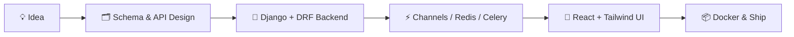

<!-- ═══════════════ HEADER ═══════════════ -->
<p align="center">
  
</p>

<!-- Typing animation -->
<p align="center">
  <a href="https://git.io/typing-svg">
    
  </a>
</p>

<p align="center">
  
  
  
  
</p>

<p align="center">
  
</p>

---

## 👨‍💻 About Me

```python
class Aniket:
    role        = "Full Stack Developer (Python-first) 🐍"
    company     = "Hexical Technology"
    experience  = "4+ years"
    education   = "MCA — Greater Noida Institute of Technology"
    location    = "India 🇮🇳"

    main_stack  = ["Python", "Django", "DRF", "Channels", "PostgreSQL", "Redis", "Celery"]
    frontend    = ["React", "Vite", "Tailwind CSS", "Redux"]
    also_works  = ["Node.js", "Express", "Socket.IO", "MongoDB"]

    currently = [
        "Building production-style backends in Django + DRF",
        "Mastering system design & backend scalability",
        "Going deeper into real-time systems (WebSockets, Redis, Celery)",
    ]

    def motto(self):
        return "Write clean code. Ship real products. Keep learning."
```

---

## 🚀 What I Do

| | |
|---|---|
| 🐍 **Backend Engineering** | Scalable Python / Django backends with clean, maintainable architecture |
| 🛠️ **REST APIs** | Production-style APIs with Django REST Framework |
| ⚡ **Real-Time Systems** | Chat, notifications & live collaboration with Django Channels + WebSockets |
| 🔐 **Auth & Security** | JWT authentication and role-based access control |
| ⏱️ **Background Jobs** | Async & scheduled tasks with Celery + Redis |
| 🎨 **Frontend** | Responsive UIs with React + Tailwind CSS |
| 📦 **DevOps Basics** | Containerize and ship with Docker |

---

## 🧰 Tech Stack

<p align="center">
  
</p>

<details>
<summary><b>🐍 Core (Python) — click to expand badges</b></summary>
<br>

<p>
  
  
  
  
  
</p>
</details>

<details>
<summary><b>🗄️ Databases & Infra</b></summary>
<br>

<p>
  
  
  
  
</p>
</details>

<details>
<summary><b>🎨 Frontend & JavaScript</b></summary>
<br>

<p>
  
  
  
  
  
  
  
</p>
</details>

<details>
<summary><b>🟢 Node Ecosystem</b></summary>
<br>

<p>
  
  
  
</p>
</details>

<details>
<summary><b>🔧 Tools</b></summary>
<br>

<p>
  
  
  
  
</p>
</details>

---

## 🔥 Featured Projects

<table>
  <tr>
    <td width="50%" valign="top">
      <h3>🏠 Airbnb Clone</h3>
      <p>Accommodation booking platform with search, listings and bookings.</p>
      
      
      
      
    </td>
    <td width="50%" valign="top">
      <h3>🤝 Real-Time Collaboration Workspace</h3>
      <p>Notion + Trello + Slack style workspace with live collaboration.</p>
      
      
      
      
      
    </td>
  </tr>
  <tr>
    <td width="50%" valign="top">
      <h3>📝 Google Docs Clone</h3>
      <p>Real-time collaborative document editing.</p>
      
      
      
      
    </td>
    <td width="50%" valign="top">
      <h3>🛒 Production E-Commerce</h3>
      <p>Production-grade store — complete backend and frontend.</p>
      
      
      
    </td>
  </tr>
  <tr>
    <td width="50%" valign="top">
      <h3>🎫 AgriSupport</h3>
      <p>Multi-role ticket management system.</p>
      
    </td>
    <td width="50%" valign="top">
      <h3>💬 Slack-like Chat Platform</h3>
      <p>Real-time chat and collaboration backend.</p>
      
      
      
      
      
    </td>
  </tr>
  <tr>
    <td colspan="2" valign="top">
      <h3>✍️ SnapRead</h3>
      <p>Medium-style blogging platform.</p>
      
    </td>
  </tr>
</table>

> 📌 Check my **pinned repositories** for live code and demos.

---

## 🧠 How I Build



---

## 🎯 Currently

- 🔨 Building production-style full-stack projects with **Django + React**
- 📚 Learning **system design** and advanced backend architecture
- ⚙️ Going deeper into **WebSockets, Redis and Celery**
- 🧪 Writing cleaner, more testable Python code

---

## 📊 GitHub Stats

<p align="center">
  
  
</p>

<p align="center">
  
</p>

<p align="center">
  
</p>

<p align="center">
  
</p>

---

## 📫 Let's Connect

<p align="center">
  <a href="https://www.linkedin.com/in/YOUR-LINKEDIN-ID">
    
  </a>
  <a href="mailto:aniketsrivastava57@gmail.com">
    
  </a>
  <a href="https://github.com/iamaniket-python">
    
  </a>
</p>

<p align="center">
  <i>"Code is like humor. When you have to explain it, it's bad."</i> 🐍
</p>

<p align="center">
  
</p>
